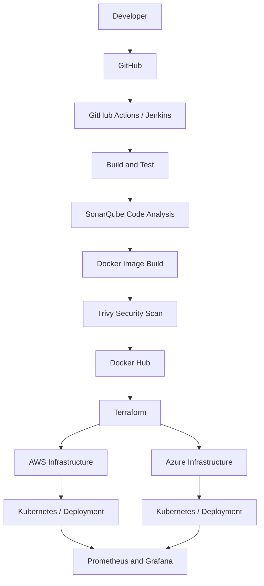

# Hey, I'm Nitin Panwar 👋

### DevOps & Cloud Engineering Enthusiast | Multi-Cloud | DevSecOps

  

  
  
  

---

## 👨‍💻 About Me

I'm a Computer Science Engineering student at **MIET**, passionate about DevOps, Cloud Computing, Multi-Cloud Infrastructure, Platform Engineering, and DevSecOps.

- 💼 **Former DevOps & Cloud Intern at HustleGrad Pvt. Ltd.**
- ☁️ Exploring cloud infrastructure across AWS and Microsoft Azure.
- ⚙️ Learning CI/CD automation with GitHub Actions and Jenkins.
- 🐳 Working with Docker, Kubernetes, Helm, and containerized applications.
- 🏗️ Practicing Infrastructure as Code using Terraform and Ansible.
- 🔐 Exploring DevSecOps with SonarQube, Trivy, and secure CI/CD practices.
- 📊 Learning monitoring and observability with Prometheus and Grafana.
- 🎯 Goal: Build secure, scalable, automated, and reliable cloud infrastructure.

I believe in learning by building real projects, solving deployment problems, and continuously improving my engineering skills.

---

## 🛠️ Tech Stack

### ☁️ Cloud Computing

  

**AWS services explored:** EC2, VPC, IAM, Elastic Load Balancing, Auto Scaling, Lambda, CloudWatch, and CloudFront.

**Azure technologies explored:** Virtual Machines, Resource Groups, Azure networking, and infrastructure deployment.

### 🐳 Containers & Orchestration

  

- Docker and Docker Hub
- Kubernetes Deployments and Services
- ConfigMaps and Secrets
- Ingress
- Horizontal Pod Autoscaler (HPA)
- Vertical Pod Autoscaler (VPA)
- Helm charts

### ⚙️ CI/CD & Automation

  

- GitHub Actions workflows
- Jenkins pipelines and Jenkinsfile
- Automated build, test, and deployment
- Docker image building, tagging, and publishing
- Pipeline troubleshooting

### 🏗️ Infrastructure as Code

  

- Terraform infrastructure provisioning
- Reusable infrastructure configurations
- Ansible configuration management
- Cloud resource automation
- Infrastructure version control

### 🔐 DevSecOps & Security

  
  

- Static code analysis with SonarQube
- Container vulnerability scanning with Trivy
- Secure CI/CD pipelines
- GitHub Secrets and Jenkins Credentials
- Least-privilege IAM principles
- Terraform security best practices
- Kubernetes Secrets and configuration management

### 📊 Monitoring & Observability

  

- Metrics collection and visualization
- Grafana dashboards
- Application and container logs
- Deployment monitoring
- Troubleshooting and incident investigation

### 💻 Programming & Development

  

- **Languages:** Python, Java, SQL
- **Backend APIs:** FastAPI, REST APIs
- **Web fundamentals:** HTML, CSS, JavaScript
- **Database:** MySQL, Supabase
- **Operating systems:** Linux, Ubuntu
- **Networking:** TCP/IP, DNS, HTTP/HTTPS, SSH, ports, and firewalls
- **Tools:** Git, GitHub, VS Code, and Postman

---

## 🔄 DevSecOps Pipeline

  
  ➜
  
  ➜
  
  ➜
  

  
  ➜
  
  ➜
  
  ➜
  

  

This represents my learning and project architecture. Individual projects may implement different stages of the pipeline.

---

## 🚀 Featured Projects

### 1. HazardLens

**AI-powered fire, smoke, and crowd detection with cloud deployment experiments.**

- Python and Streamlit application
- YOLO-based detection
- AWS infrastructure and deployment experiments
- Terraform infrastructure code
- Kubernetes deployment and autoscaling experiments

**Technologies:** Python, Streamlit, YOLO, AWS, Terraform, Docker, Kubernetes

  
  
  

### 2. RoadGuard AI

**AI-powered pothole detection and reporting platform.**

- Computer vision for pothole detection
- Web application and API integration
- Reporting and data storage workflows
- Cloud deployment experiments

**Technologies:** Next.js, FastAPI, Supabase, Python, Computer Vision

> Add the verified public GitHub repository URL for this project.

### 3. DevOps Log Analyzer

**A FastAPI-based tool to analyze CI/CD logs and help investigate pipeline failures.**

- Log analysis for Jenkins and GitHub Actions
- Webhook-based log ingestion
- AI-assisted failure analysis
- Troubleshooting support for deployment workflows

**Technologies:** Python, FastAPI, REST APIs, CI/CD, AI integration

> Add the verified public GitHub repository URL for this project.

### 4. Milky Macron Bakery

**A learning project focused on GitHub Actions CI/CD and Docker image automation.**

- Automated Docker image builds
- Image tagging
- Docker Hub publishing workflows
- GitHub Actions pipeline practice

**Technologies:** GitHub Actions, Docker, Docker Hub, GitHub

  

---

## 🌐 Multi-Cloud DevSecOps Platform

**Project direction: Secure and automated infrastructure across AWS and Microsoft Azure.**

The objective is to bring infrastructure automation, CI/CD, security scanning, containerization, and observability together in a reusable workflow.

### Architecture

### Security & Reliability Goals

- Automate build, test, and deployment workflows.
- Scan container images for known vulnerabilities.
- Provision cloud resources through version-controlled Terraform.
- Apply least-privilege access and secure secret handling.
- Monitor application health, metrics, and logs.
- Practice repeatable deployments across cloud environments.

**Technologies:** AWS, Microsoft Azure, GitHub Actions, Jenkins, SonarQube, Docker, Trivy, Terraform, Kubernetes, Prometheus, Grafana.

*This section describes the intended architecture and learning goals. It should not be interpreted as a claim that every component is already deployed or operational.*

---

## 💼 Experience

### Former DevOps & Cloud Intern — HustleGrad Pvt. Ltd.

- Gained practical exposure to DevOps and cloud engineering workflows.
- Worked on SaaS dashboard deployment activities.
- Practiced application configuration, environment setup, and troubleshooting.
- Explored containerization, deployment automation, and cloud infrastructure concepts.

My focus is on translating practical experience into reliable, secure, and repeatable deployment workflows.

---

## 📚 Currently Learning

- Advanced Kubernetes and Helm
- Multi-cloud infrastructure with AWS and Azure
- Terraform modules and infrastructure automation
- Jenkins and GitHub Actions pipelines
- DevSecOps with SonarQube and Trivy
- Prometheus, Grafana, and observability
- Linux administration and networking
- Cloud security and infrastructure best practices

---

## 🏆 Achievements & Activities

- Former DevOps & Cloud Intern at HustleGrad Pvt. Ltd.
- Finalist in the Builder with Bharat Microsoft hackathon.
- Building cloud, AI, and DevOps-focused projects.
- Practicing CI/CD automation and infrastructure as code.
- Actively learning through hands-on development and technical communities.

---

## 📊 GitHub Statistics

  
  

  

  

  

*GitHub language statistics reflect repository contents and are not a direct measurement of proficiency. External statistics services may occasionally be unavailable.*

---

## 🤝 Let's Connect

  
  

- 💼 Open to DevOps and Cloud Engineering internship opportunities.
- 🤝 Interested in collaborating on cloud-native, DevSecOps, and open-source projects.
- 📧 Email: Add your professional email address.
- 🔗 LinkedIn: Replace the generic link with your actual profile URL.

---

  <b>Automate. Secure. Deploy. Monitor. Improve. 🚀</b>

  Thanks for visiting my profile!

