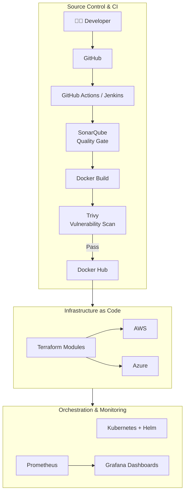

<!-- ============================================================
  nitin-panwar-6963 / README.md
  Banner image lives in this repo at: assets/banner.png
  (see the setup steps below the README)
============================================================= -->

<!-- ============ HEADER / BANNER ============ -->

  

<h1 align="center">Hi there, I'm <a href="https://github.com/nitin-panwar-6963">Nitin Panwar</a> 👋</h1>

  

  
  
  

  

---

## 🚀 About Me

- 🎓 **Computer Science Engineering** student at **MIET** (expected graduation **2028**)
- 💼 **Former DevOps & Cloud Intern at HustleGrad Pvt. Ltd.**
- ☁️ Interested in **Cloud Engineering**, **Platform Engineering**, **Multi-Cloud Infrastructure**, **Kubernetes**, **Infrastructure as Code**, and **DevSecOps**
- 🔨 Learning hands-on through **projects**, **deployment automation**, and **troubleshooting**
- 🎯 Looking for **DevOps / Cloud Engineering internships** and open to **open-source collaboration**

---

## 🧰 Tech Stack

  <b>✅</b> Hands-on experience &nbsp;·&nbsp; <b>📚</b> Currently learning

### ☁️ Cloud Platforms

<table>
  <tr>
    <td align="center" width="120" valign="top">
       
      <b>AWS</b> 
      ✅ Hands-on
    </td>
    <td align="center" width="120" valign="top">
       
      <b>Azure</b> 
      📚 Learning
    </td>
  </tr>
</table>

  <b>AWS — hands-on:</b> EC2, VPC, IAM, Elastic Load Balancing, Auto Scaling, Lambda, CloudWatch, CloudFront 
  <b>Azure — learning:</b> Virtual Machines, Resource Groups, Virtual Networking, Infrastructure Deployment

### 🐳 Containers & Orchestration

<table>
  <tr>
    <td align="center" width="120" valign="top">
       
      <b>Docker</b> 
      ✅ Hands-on
    </td>
    <td align="center" width="120" valign="top">
       
      <b>Kubernetes</b> 
      ✅ Hands-on
    </td>
    <td align="center" width="120" valign="top">
       
      <b>Helm</b> 
      📚 Learning
    </td>
  </tr>
</table>

<b>Kubernetes in practice:</b> Deployments, Services, Ingress, ConfigMaps, Secrets, HPA/VPA · <b>Docker Hub:</b> image build → tag → publish

### 🔄 CI/CD & Automation

<table>
  <tr>
    <td align="center" width="120" valign="top">
       
      <b>Git</b> 
      ✅ Hands-on
    </td>
    <td align="center" width="120" valign="top">
       
      <b>GitHub</b> 
      ✅ Hands-on
    </td>
    <td align="center" width="120" valign="top">
       
      <b>Jenkins</b> 
      ✅ Hands-on
    </td>
    <td align="center" width="150" valign="top">
       
      <b>GitHub Actions</b> 
      ✅ Hands-on
    </td>
  </tr>
</table>

<b>Automated:</b> builds, testing workflows, Jenkinsfile pipelines, Docker image build/tag/publish, deployment automation

### 🏗️ Infrastructure as Code

<table>
  <tr>
    <td align="center" width="120" valign="top">
       
      <b>Terraform</b> 
      ✅ Hands-on
    </td>
    <td align="center" width="120" valign="top">
       
      <b>Ansible</b> 
      📚 Learning
    </td>
  </tr>
</table>

<b>Terraform:</b> reusable configurations, cloud resource provisioning, infrastructure automation · <b>Ansible:</b> configuration management

### 🔐 DevSecOps & Security

  <b>Secure pipelines:</b> GitHub Secrets, Jenkins Credentials, Kubernetes Secrets · <b>IAM:</b> least-privilege policies · <b>Terraform:</b> security practices

### 📊 Monitoring & Observability

<table>
  <tr>
    <td align="center" width="120" valign="top">
       
      <b>Prometheus</b> 
      ✅ Hands-on
    </td>
    <td align="center" width="120" valign="top">
       
      <b>Grafana</b> 
      ✅ Hands-on
    </td>
  </tr>
</table>

<b>In practice:</b> metrics collection, dashboard visualization, application & container logging, troubleshooting and incident analysis

### 💻 Programming & Development

<table>
  <tr>
    <td align="center" width="110" valign="top"> <b>Python</b></td>
    <td align="center" width="110" valign="top"> <b>Java</b></td>
    <td align="center" width="110" valign="top"> <b>SQL</b></td>
    <td align="center" width="110" valign="top"> <b>FastAPI</b></td>
  </tr>
  <tr>
    <td align="center" valign="top"> <b>HTML</b></td>
    <td align="center" valign="top"> <b>CSS</b></td>
    <td align="center" valign="top"> <b>JavaScript</b></td>
    <td align="center" valign="top"> <b>MySQL</b></td>
  </tr>
  <tr>
    <td align="center" valign="top"> <b>Supabase</b></td>
    <td align="center" valign="top"> <b>REST APIs</b></td>
  </tr>
</table>

### 🖥️ Operating Systems & Networking

<table>
  <tr>
    <td align="center" width="110" valign="top"> <b>Linux</b></td>
    <td align="center" width="110" valign="top"> <b>Ubuntu</b></td>
    <td align="center" width="110" valign="top"> <b>Bash</b></td>
  </tr>
</table>

<b>Networking fundamentals:</b> TCP/IP, DNS, HTTP/HTTPS, SSH, ports & firewalls · <b>Shell scripting:</b> Bash automation

### 🛠️ Developer Tools

<table>
  <tr>
    <td align="center" width="110" valign="top"> <b>VS Code</b></td>
    <td align="center" width="110" valign="top"> <b>Postman</b></td>
    <td align="center" width="110" valign="top"> <b>Git CLI</b></td>
  </tr>
</table>

---

## 🔁 DevSecOps CI/CD Pipeline

> ℹ️ This is my **learning and project architecture** — not every stage is deployed in every project.

```mermaid
flowchart LR
    A[👨‍💻 Developer] --> B[GitHub]
    B --> C[CI: GitHub Actions / Jenkins]
    C --> D[Build & Test]
    D --> E[SonarQube<br/>Code Quality]
    E --> F[Docker Build]
    F --> G[Trivy<br/>Security Scan]
    G --> H[Docker Hub]
    H --> I[Terraform<br/>Infrastructure as Code]
    I --> J[AWS / Azure<br/>Cloud Deployment]
    J --> K[Kubernetes / Helm<br/>Deployment]
    K --> L[Prometheus + Grafana<br/>Monitoring]
```

| Stage | What it does |
|---|---|
| CI/CD automation | Automated build, test, and deployment on every push |
| Code quality checks | SonarQube static analysis gates before shipping |
| Container image scanning | Trivy catches vulnerabilities before images are published |
| Infrastructure provisioning | Terraform creates cloud resources repeatably |
| Cloud deployment | Workloads land on AWS and/or Azure |
| Container orchestration | Kubernetes/Helm runs and scales the containers |
| Monitoring & observability | Prometheus collects metrics, Grafana visualizes them |

---

## 🌟 Featured Projects

### 🛡️ 1. HazardLens

**AI-powered fire, smoke, and crowd detection application with cloud deployment experiments.**

- 🔥 Fire & smoke detection powered by YOLO computer vision
- 👥 Crowd detection for safety monitoring
- ☁️ Containerized and explored cloud deployment with Terraform

🔗 **Repository:** [hazardlens](https://github.com/nitin-panwar-6963/hazardlens) · **Terraform:** [hazardlens-terraform](https://github.com/nitin-panwar-6963/hazardlens-terraform) · **Kubernetes:** [hazardlens-k8s](https://github.com/nitin-panwar-6963/hazardlens-k8s)

### 🛣️ 2. RoadGuard AI

**AI-powered pothole detection and reporting platform.**

- 🕳️ AI-based pothole detection from road imagery
- 📋 Reporting workflows for road issues
- 🔌 REST API integration
- ☁️ Cloud deployment experiments

🔗 **Repository:** `<!-- ADD VERIFIED REPO LINK HERE -->` *(placeholder — link will be added once verified)*

### 🧾 3. DevOps Log Analyzer

**FastAPI-based tool for analyzing CI/CD logs and investigating pipeline failures.**

- 📥 Webhook-based log ingestion from CI/CD pipelines
- 🤖 AI-assisted troubleshooting of pipeline failures (where applicable)
- 🔍 Fast analysis of Jenkins / GitHub Actions build logs

🔗 **Repository:** `<!-- ADD VERIFIED REPO LINK HERE -->` *(placeholder — link will be added once verified)*

### 🥐 4. Milky Macron Bakery

**A learning project demonstrating CI/CD automation using GitHub Actions and Docker.**

- 🐳 Docker image build and tagging
- 📤 Publishing images to Docker Hub
- ⚙️ End-to-end GitHub Actions workflow automation

🔗 **Repository:** [milky-macron-bakery](https://github.com/nitin-panwar-6963/milky-macron-bakery)

---

## ☁️⭐ Multi-Cloud DevSecOps Automation Platform

> ⚠️ **Status: under development / proposed architecture** — the full multi-cloud pipeline is not yet running in production. This section describes my target design that I'm progressively implementing.

**🎯 Objective:** Design and progressively implement **secure, repeatable application deployments** across **AWS and Microsoft Azure** using one automated, security-gated pipeline.

### Architecture

- **🔒 Security controls:** SonarQube quality gates, Trivy image scanning, least-privilege IAM, GitHub Secrets / Jenkins Credentials / Kubernetes Secrets
- **⚙️ CI/CD workflow:** push → build → quality check → scan → publish → provision → deploy
- **🌍 Multi-cloud strategy:** identical Terraform-driven deployments target AWS and Azure, so workloads can run on either provider
- **📈 Monitoring strategy:** Prometheus metrics collected from clusters, visualized in Grafana dashboards
- **🚀 Potential future improvements:** GitOps (Argo CD), policy as code, service mesh, centralized multi-cloud observability

🔗 **Repository:** `<!-- ADD REPO LINK WHEN AVAILABLE -->` *(placeholder — link will be added once the repository is published)*

---

## 💼 Professional Experience

### DevOps & Cloud Intern — HustleGrad Pvt. Ltd.

- Gained **practical exposure** to DevOps and cloud engineering workflows
- Contributed to **SaaS dashboard deployment** activities
- Handled **application configuration and environment setup**
- Performed **deployment troubleshooting**
- Built knowledge of **containerization and cloud infrastructure**
- Strengthened understanding of **CI/CD and automation concepts**

---

## 📊 GitHub Statistics

> ℹ️ Language statistics reflect **repository contents**, not skill level.

  
  

  

  

  

---

## 📚 Currently Learning

> 🎯 These are my **current learning goals** — distinct from the hands-on experience shown above.

- Advanced **Kubernetes** and **Helm**
- **Terraform modules** and reusable infrastructure patterns
- **AWS and Azure architecture**
- **Multi-cloud automation**
- **Jenkins and GitHub Actions** at scale
- **DevSecOps** practices with **SonarQube and Trivy**
- **Prometheus and Grafana** observability stacks
- **Linux administration**
- **Networking and shell scripting**

---

## 🏆 Achievements

- 💼 **Former DevOps & Cloud Intern** at HustleGrad Pvt. Ltd.
- 🏅 **Builder with Bharat (Microsoft) hackathon finalist** <!-- verify this against the official results page before publishing -->
- 🔨 **Hands-on DevOps and cloud projects** across containers, CI/CD, and IaC
- 📖 **Consistent technical learning** and community participation

---

## 🤝 Connect With Me

  
  
  

---

  <i>Automate · Deploy · Scale · Secure</i> ☁️

