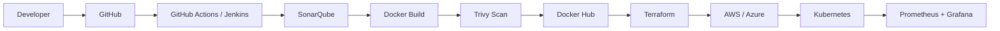

<!-- Banner: repo me assets/banner.png rakho (steps chat me diye hain) -->

  

  

  

  
  
  

---

## 🚀 About Me

- 🎓 CSE student at **MIET** · Graduating **2028**
- 💼 Former **DevOps & Cloud Intern** at **HustleGrad Pvt. Ltd.**
- 🎯 Looking for **DevOps / Cloud internships** & open-source collaboration

---

## 🧰 Tech Stack

<table>
  <tr>
    <th align="center" width="220">Category</th>
    <th align="center" width="520">Technologies</th>
  </tr>
  <tr>
    <td align="center"><b>☁️ Cloud</b></td>
    <td align="center"></td>
  </tr>
  <tr>
    <td align="center"><b>🏗️ Infrastructure as Code</b></td>
    <td align="center"></td>
  </tr>
  <tr>
    <td align="center"><b>🔄 DevOps & CI/CD</b></td>
    <td align="center"></td>
  </tr>
  <tr>
    <td align="center"><b>🐳 Containers</b></td>
    <td align="center">
      
      
    </td>
  </tr>
  <tr>
    <td align="center"><b>🔐 DevSecOps</b></td>
    <td align="center">
      
      
    </td>
  </tr>
  <tr>
    <td align="center"><b>📊 Monitoring</b></td>
    <td align="center"></td>
  </tr>
  <tr>
    <td align="center"><b>🗄️ Database</b></td>
    <td align="center"></td>
  </tr>
  <tr>
    <td align="center"><b>💻 Languages & Frameworks</b></td>
    <td align="center"></td>
  </tr>
  <tr>
    <td align="center"><b>🖥️ OS & Scripting</b></td>
    <td align="center"></td>
  </tr>
</table>

---

## 🔁 My DevSecOps Pipeline

---

## 🌟 Projects

### 🛡️ HazardLens
AI fire, smoke & crowd detection using **YOLO**, containerized with Docker, Terraform & Kubernetes.

🔗 [App](https://github.com/nitin-panwar-6963/hazardlens) · [Terraform](https://github.com/nitin-panwar-6963/hazardlens-terraform) · [Kubernetes](https://github.com/nitin-panwar-6963/hazardlens-k8s)

### 🛣️ RoadGuard AI
AI pothole detection & reporting platform with REST API.

🔗 <!-- ADD REPO LINK --> *Coming soon*

### 🧾 DevOps Log Analyzer
FastAPI tool that ingests CI/CD logs via webhooks and helps debug Jenkins / GitHub Actions failures.

🔗 <!-- ADD REPO LINK --> *Coming soon*

### ☁️ Multi-Cloud DevSecOps Automation Platform &nbsp; `🚧 In Progress`
One secure, automated pipeline to deploy apps on **AWS & Azure** — SonarQube quality gate → Trivy scan → Terraform → Kubernetes/Helm → Prometheus & Grafana monitoring.

🔗 <!-- ADD REPO LINK WHEN PUBLISHED --> *Coming soon*

---

## 💼 Experience

**DevOps & Cloud Intern — HustleGrad Pvt. Ltd.**
SaaS dashboard deployment · environment setup & configuration · deployment troubleshooting · containers & CI/CD basics

---

## 📊 GitHub Stats

  
  

  

---

## 📚 Currently Learning
Kubernetes & Helm · Terraform modules · AWS/Azure architecture · DevSecOps · Observability

## 🏆 Achievements
- 🏅 Builder with Bharat (Microsoft) hackathon finalist <!-- official result se verify karke hi rakho -->

---

## 🤝 Connect

  
  
  

<i>Automate · Deploy · Scale · Secure</i> ☁️

